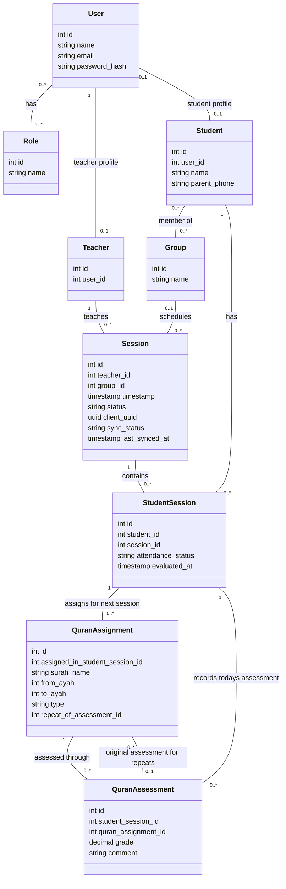

# School Management Class Diagram

Implementation priority is defined in the [MVP scope](mvp.md). Parent features and Telegram are deferred and excluded from this class diagram.

This file is the authoritative design reference for the Laravel school management study project. Keep the Mermaid diagram and the rules below in sync.

## UML class diagram

## Business rules

- Administrators create teacher accounts and assign or reset their passwords. Only `User.password_hash` is stored; passwords are never returned in user/profile responses. API authentication uses JWT as specified in the MVP architecture.
- The current roles are Administrator, Teacher, and Student. One account can have more than one role.
- Each session has one teacher and can include several students.
- Save the session and all student work automatically on the teacher's device from creation onward, including when offline. Creating a session does not require uploading it immediately. Required group, roster, and earlier-assignment data must already be available locally for offline use.
- Session completion and synchronization are separate: `status` starts as `in_progress` and becomes `completed` when the teacher selects **Finish and send session**. A completed session may still be waiting for upload.
- A new local session has `sync_status = local_only`. Finishing queues a durable local submission (`pending_upload`); while transmitting, show `uploading`. Only a successful server acknowledgement for the submitted revision changes it to `synced`.
- If there is no connection or an upload fails, keep the complete submission on the device as `pending_upload`. Show **Waiting to send** with **Retry**; never report success or clear local work before acknowledgement. Recover interrupted uploads as pending when the application restarts.
- Send the session, attendance, assignments, and assessments together. The server must authorize and validate the submission and save it atomically. Repeated sends of the same submission must not create duplicate sessions or child records; use the stable client UUID and a submission revision/idempotency key.
- Editing a saved session is allowed; deleting it is not. Edits to an already uploaded session are saved locally, move its sync state to `local_only`, and require another explicit finish-and-send action. Preserve the server's last accepted revision until the new revision is acknowledged. Never mark newer local edits as synced merely because an earlier upload succeeds.
- While a session is in progress, students not yet finished display as **Not evaluated yet**. The teacher's **Finish student** action sets `evaluated_at` and marks the student `present`. On **Finish and send session**, roster students whose `evaluated_at` is null are marked `absent`; list their names for confirmation before submission.
- Evaluation completion is explicit, not inferred from whether a grade exists. A student without earlier assignments can still be finished after reviewing their work or assigning next passages. Missing grades do not default to zero.
- A group has a name and can contain several students. The initial design allows a student to belong to several groups, with each student/group membership stored only once.
- A session can optionally belong to one group, allowing sessions without a group as well. The teacher is assigned to each session.
- `StudentSession` records remain the attendance roster for each session. Changing group membership must not change past session records.
- Attendance is recorded through student/session completion as described above; finishing a previously absent student during correction marks them present in the next submitted revision. Each student has at most one `StudentSession` record per session.
- For each student in a Quran session, the teacher has two sections: **Today's assessment**, which records a grade and optional comment for each previously assigned passage recited today, and **Next session's assignments**, which records passages to prepare.
- Both sections support `new_memorization` and `revision`. Each assigned passage has its own `QuranAssignment`; each assessment of that passage has its own `QuranAssessment` and grade. The assessment gets its passage and type from the assignment, rather than duplicating them.
- Each assignment covers one surah, selected by name, and an inclusive ayah range, such as Al-Mulk, ayahs 1–10. Assignments are linked to the student's session in which they were given; assessments are linked to the student's session in which the recitation was assessed. The assignment must have been given earlier than its assessment.
- An assessment and its assignment must belong to the same student, through their respective `StudentSession` records. An assignment may remain unassessed or have several assessments over time.
- After an assessment, the teacher can assign a repeat of the full passage or a smaller range within it. Store this as a new `QuranAssignment` linked to the original assessment, for the same student and surah. Each repeat has exactly one original assessment; an ordinary assignment has none. An assessment can lead to several repeat assignments.
- Preserve the original assessment and grade when assigning a repeat. Assessing the repeat creates a separate assessment and grade linked to the new assignment.
- Example: a student receives **6/10** for Al-Mulk, ayahs **1–10**. The teacher assigns ayahs **4–6** for the next session, linking the new assignment to that assessment. When ayahs 4–6 are assessed, their new grade is stored separately; the original 6/10 remains unchanged. The grading scale is 0–10 inclusive.
- An administrator can view all teachers, students, groups, and sessions stored on the server, including attendance records, grades, and comments. Work stored only on a teacher's device is unavailable to other accounts until sent.

## Attribute notes

- `Session.group_id` is optional. In Laravel, use a `group_student` pivot table with a unique `(group_id, student_id)` pair for group memberships.
- `Session.status` is required and is `in_progress` or `completed`, defaulting to `in_progress`.
- `Session.client_uuid` is generated on the device when the session is created, stays unchanged across retries, and is unique on the server. `Session.id` remains the server primary key; local records need stable local identifiers before server IDs exist, with references reconciled on upload.
- `Session.sync_status` is device-local metadata, not a server-controlled visibility flag. Its values are `local_only`, `pending_upload`, `uploading`, and `synced`; default to `local_only`. These fields describe the combined offline/online model; do not treat every local field as a Laravel database column.
- `Session.last_synced_at` is nullable and records the last server acknowledgement time, not the time of local saving. It remains unchanged during unsent edits or failed retries.
- Persist local records and queued submissions durably (for example, in IndexedDB). A local save failure must be shown separately from an upload failure; only show **Saved on device** after successful local persistence. Browser storage can be cleared or lost and is not a server backup.
- `Session.timestamp` stores the session date and time in one field.
- A teacher uses the name and email from their account. A student record has a name so it can exist without an account.
- `Student.id` is generated by the database; administrators do not enter or edit it. There is no separate manually entered student number.
- `Student.user_id` is optional.
- `Student.parent_phone` is an optional contact number for the student's parent or guardian. Store it as a string including the country code when available. It does not create a parent account or Telegram subscription. The same number may be used for siblings; it is not unique.
- The MVP stores one parent/guardian contact number per student; multiple contacts and parent profiles are deferred.
- `StudentSession.evaluated_at` is nullable and records when the teacher explicitly finishes the student. Before session completion, a null value means not evaluated yet; on completion it determines absence. `attendance_status` starts as `not_marked` and becomes `present` or `absent` under these rules.
- `StudentSession.id` is the primary key. Keep a unique constraint on `(student_id, session_id)` so each student has only one attendance record per session. Grades and comments belong to `QuranAssessment`, not `StudentSession`.
- `QuranAssignment.assigned_in_student_session_id` references `StudentSession.id` and identifies when and to whom the assignment was given.
- `QuranAssignment.surah_name`, `from_ayah`, `to_ayah`, and `type` are required. Validate the selected surah and ensure `1 <= from_ayah <= to_ayah` within that surah's ayah count. `type` must be `new_memorization` or `revision`.
- `QuranAssignment.repeat_of_assessment_id` is nullable and references `QuranAssessment.id`. For a repeat, validate that the student and surah match the original assessed assignment and that the new range is contained within its range (the full range is allowed).
- `QuranAssessment.student_session_id` references the session attendance record where recitation was assessed; `quran_assignment_id` references the assignment being checked. Both references are required. Validate that both records belong to the same student.
- `QuranAssessment.grade` is required; `comment` is optional. The passage and type are obtained through `quran_assignment_id`. Validate a numeric grade in the inclusive range 0–10; decimals are allowed.

## Open decisions

- Confirm whether every student needs an account. The diagram currently allows a student record without one.
- Confirm whether administrators can also correct attendance or grades entered by a teacher.
- Confirm whether students can belong to several groups and whether every session must belong to a group. The initial design allows multiple memberships and optional session groups.
- Decide whether creating a group session automatically creates its `StudentSession` roster from current group members.
- Decide how to resolve concurrent edits from multiple devices, including submission version checks and conflict recovery. Until resolved, never silently overwrite a newer server revision.
- Decide how long to retain acknowledged local submissions, how offline data is refreshed, and whether automatic retry supplements the explicit Retry action.
