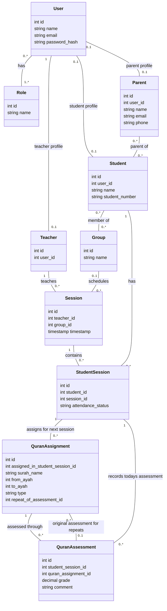

# School Management Class Diagram

This file is the authoritative design reference for the Laravel school management study project. Keep the Mermaid diagram and the rules below in sync.

## UML class diagram

## Business rules

- The four roles are Administrator, Teacher, Student, and Parent. One account can have more than one role.
- Each session has one teacher and can include several students.
- A group has a name and can contain several students. The initial design allows a student to belong to several groups, with each student/group membership stored only once.
- A session can optionally belong to one group, allowing sessions without a group as well. The teacher is assigned to each session.
- `StudentSession` records remain the attendance roster for each session. Changing group membership must not change past session records.
- The teacher records attendance for each student in their session. Each student has at most one `StudentSession` record per session.
- For each student in a Quran session, the teacher has two sections: **Today's assessment**, which records a grade and optional comment for each previously assigned passage recited today, and **Next session's assignments**, which records passages to prepare.
- Both sections support `new_memorization` and `revision`. Each assigned passage has its own `QuranAssignment`; each assessment of that passage has its own `QuranAssessment` and grade. The assessment gets its passage and type from the assignment, rather than duplicating them.
- Each assignment covers one surah, selected by name, and an inclusive ayah range, such as Al-Mulk, ayahs 1–10. Assignments are linked to the student's session in which they were given; assessments are linked to the student's session in which the recitation was assessed. The assignment must have been given earlier than its assessment.
- An assessment and its assignment must belong to the same student, through their respective `StudentSession` records. An assignment may remain unassessed or have several assessments over time.
- After an assessment, the teacher can assign a repeat of the full passage or a smaller range within it. Store this as a new `QuranAssignment` linked to the original assessment, for the same student and surah. Each repeat has exactly one original assessment; an ordinary assignment has none. An assessment can lead to several repeat assignments.
- Preserve the original assessment and grade when assigning a repeat. Assessing the repeat creates a separate assessment and grade linked to the new assignment.
- Example: a student receives **12/20** for Al-Mulk, ayahs **1–10**. The teacher assigns ayahs **4–6** for the next session, linking the new assignment to that assessment. When ayahs 4–6 are assessed, their new grade is stored separately; the original 12/20 remains unchanged. This score is illustrative; the grading scale is still open.
- A parent record can exist without a user account, so the school can store contact details now and connect the parent to the system later.
- A parent with a linked account can view only their children's session records. A student can be linked to more than one parent, and a parent can be linked to several students.
- Parents should be able to receive notifications in a later phase. The delivery channels and triggering events remain to be decided; no delivery mechanism is implemented yet.
- An administrator can view all teachers, students, parents, groups, and sessions, including all attendance records, grades, and comments.

## Attribute notes

- `Session.group_id` is optional. In Laravel, use a `group_student` pivot table with a unique `(group_id, student_id)` pair for group memberships.
- `Session.timestamp` stores the session date and time in one field.
- A teacher uses the name and email from their account. A student record has a name so it can exist without an account.
- `Student.user_id` and `Parent.user_id` are optional. Each linked user account has at most one parent profile.
- `Parent.name` is required; `Parent.email` and `Parent.phone` are optional contact details, independent of login credentials.
- Linking a parent to an account later must preserve their contact details and student relationships.
- `StudentSession.id` is the primary key. Keep a unique constraint on `(student_id, session_id)` so each student has only one attendance record per session. Grades and comments belong to `QuranAssessment`, not `StudentSession`.
- `QuranAssignment.assigned_in_student_session_id` references `StudentSession.id` and identifies when and to whom the assignment was given.
- `QuranAssignment.surah_name`, `from_ayah`, `to_ayah`, and `type` are required. Validate the selected surah and ensure `1 <= from_ayah <= to_ayah` within that surah's ayah count. `type` must be `new_memorization` or `revision`.
- `QuranAssignment.repeat_of_assessment_id` is nullable and references `QuranAssessment.id`. For a repeat, validate that the student and surah match the original assessed assignment and that the new range is contained within its range (the full range is allowed).
- `QuranAssessment.student_session_id` references the session attendance record where recitation was assessed; `quran_assignment_id` references the assignment being checked. Both references are required. Validate that both records belong to the same student.
- `QuranAssessment.grade` is required; `comment` is optional. The passage and type are obtained through `quran_assignment_id`. The grading scale and valid grade range remain to be decided.

## Open decisions

- Confirm whether every student needs an account. The diagram currently allows a student record without one.
- Decide the grading scale and valid grade range for Quran assessments. The 12/20 example does not establish a fixed scale.
- Confirm whether administrators can also correct attendance or grades entered by a teacher.
- Decide which events notify parents (for example, attendance or grade updates), which channels to use (in-app, email, or SMS), and whether parents without accounts can receive notifications.
- Confirm whether students can belong to several groups and whether every session must belong to a group. The initial design allows multiple memberships and optional session groups.
- Decide whether creating a group session automatically creates its `StudentSession` roster from current group members.
