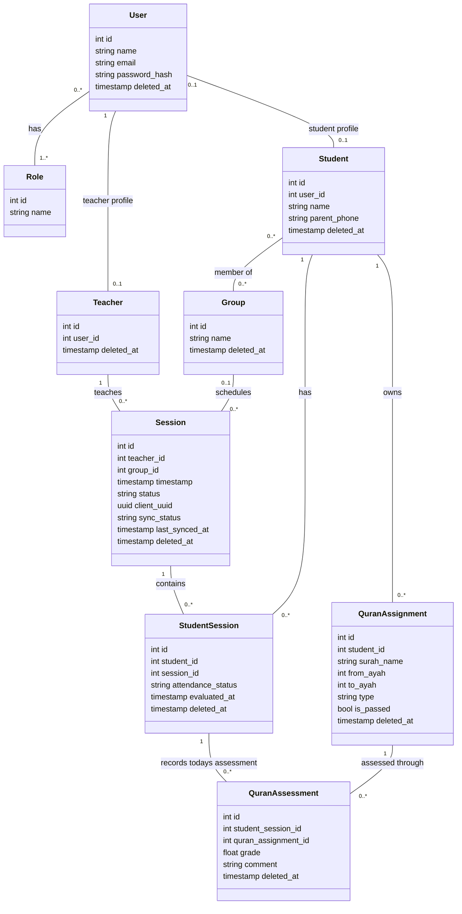

# School Management Class Diagram

Implementation priority is defined in the [MVP scope](mvp.md). Parent features and Telegram are deferred and excluded from this class diagram.

Delivery 1 implements the database and Filament; teacher API, JWT, and offline/synchronization behavior below belong to a later delivery. See the [Laravel plan](laravel-plan.md). Local sync metadata is not a required server table field.

This file is the authoritative design reference for the Laravel school management study project. Keep the Mermaid diagram and the rules below in sync.

**Implementation status:** Laravel models and migrations now follow this diagram, with student-owned assignments, `is_passed`, and full administrator CRUD using soft deletion/restoration. The standalone teacher prototype still uses the previous assignment design and remains a historical interaction reference.

## UML class diagram

## Business rules

- Administrators create administrator and teacher accounts and assign or reset their passwords. Only `User.password_hash` is stored; passwords are never returned in user/profile responses. Filament uses Laravel session authentication; JWT is deferred to the later teacher API delivery.
- The current roles are Administrator, Teacher, and Student. One account can have more than one role.
- Each session has one teacher and can include several students.
- Save the session and all student work automatically on the teacher's device from creation onward, including when offline. Creating a session does not require uploading it immediately. Required group, roster, and earlier-assignment data must already be available locally for offline use.
- Session completion and synchronization are separate: `status` starts as `in_progress` and becomes `completed` when the teacher selects **Finish and send session**. A completed session may still be waiting for upload.
- A new local session has `sync_status = local_only`. Finishing queues a durable local submission (`pending_upload`); while transmitting, show `uploading`. Only a successful server acknowledgement for the submitted revision changes it to `synced`.
- If there is no connection or an upload fails, keep the complete submission on the device as `pending_upload`. Show **Waiting to send** with **Retry**; never report success or clear local work before acknowledgement. Recover interrupted uploads as pending when the application restarts.
- Send the session, attendance, assignments, and assessments together. The server must authorize and validate the submission and save it atomically. Repeated sends of the same submission must not create duplicate sessions or child records; use the stable client UUID and a submission revision/idempotency key.
- Teachers can edit saved sessions without deleting them. Administrators can create/edit sessions and soft-delete/restore them under the archive rules below. Edits to an already uploaded session are saved locally, move its sync state to `local_only`, and require another explicit finish-and-send action. Preserve the server's last accepted revision until the new revision is acknowledged. Never mark newer local edits as synced merely because an earlier upload succeeds.
- While a session is in progress, students not yet finished display as **Not evaluated yet**. The teacher's **Finish student** action sets `evaluated_at` and marks the student `present`. On **Finish and send session**, roster students whose `evaluated_at` is null are marked `absent`; list their names for confirmation before submission.
- Evaluation completion is explicit, not inferred from whether a grade exists. A student without earlier assignments can still be finished after reviewing their work or assigning next passages. Missing grades do not default to zero.
- A group has a name and can contain several students. The initial design allows a student to belong to several groups, with each student/group membership stored only once.
- A session can optionally belong to one group, allowing sessions without a group as well. The teacher is assigned to each session.
- `StudentSession` records remain the attendance roster for each session. Changing group membership must not change past session records.
- Attendance is recorded through student/session completion as described above; finishing a previously absent student during correction marks them present in the next submitted revision. Each student has at most one `StudentSession` record per session.
- For each student in a Quran session, the teacher has two sections: **Today's assessment**, which records a grade and optional comment for each previously assigned passage recited today, and **Next session's assignments**, which records passages to prepare.
- Both sections support `new_memorization` and `revision`. Each assigned passage has its own `QuranAssignment`; each assessment of that passage has its own `QuranAssessment` and grade. The assessment gets its passage and type from the assignment, rather than duplicating them.
- Each assignment belongs directly to one student and covers one surah, selected by name, with an inclusive ayah range and type. It has no assigning-session relationship; the model does not record which session or teacher originally assigned it.
- Each assessment references one assignment and one `StudentSession`, identifying the student and session of that attempt. Its assignment's `student_id` must match the roster record's `student_id`. An assignment can have several assessments across sessions, preserving every attempt's grade and comment.
- `QuranAssignment.is_passed` starts as `false` (pending). After assessing a passage, the teacher explicitly chooses whether to set it to `true` (passed). A grade or the existence of an assessment never automatically marks it passed; no passing threshold is defined.
- If the full passage needs another attempt, keep the same assignment pending and record a new assessment in a later session. Do not create a copy or replace an earlier assessment. Passed assignments leave the pending list, but all attempts remain visible in history.
- For a smaller passage, create a separate pending assignment for the same student with the smaller ayah range. Preserve the original passage and all its assessments. No repeat/source foreign key is required; the original assignment's `is_passed` value remains an explicit teacher decision.
- Example: a student receives a grade of **6** for Al-Mulk, ayahs **1–10**. The teacher leaves the assignment pending. A later session records a new assessment on that same assignment; when satisfied, the teacher marks it passed. If only ayahs **4–6** need practice, the teacher can instead create a separate pending assignment for that range. Earlier grades remain unchanged.
- An administrator can view all teachers, students, groups, and sessions stored on the server, including attendance records, grades, and comments. Work stored only on a teacher's device is unavailable to other accounts until sent.

- Administrators have full create/edit/soft-delete/restore permissions for other administrator accounts, teachers, students, groups, sessions, roster/attendance records, assignments, and assessments. This includes passage edits, `is_passed`, attendance correction, assessment creation, and correcting links to another valid assignment/roster pair belonging to the same student. Grade/comment-only correction remains available as a shortcut.
- Administrative passage edits change the shared assignment metadata shown by its assessment attempts; they do not erase earlier grade/comment records. Administrators explicitly control `is_passed`; editing a grade never changes it automatically.
- Use soft deletion through nullable `deleted_at`. Deleting one record does not delete or archive related records or pivot memberships. Keep historical relationships readable even when their parent is archived. Restore the same row and ID; do not create replacement records. Permanent deletion is not exposed in the administrator panel.
- Administrator accounts are Users with the Administrator role; there is no separate Administrator model/table. All active administrators have the same management privileges. A user can edit its own account but cannot delete it, directly or in a bulk operation. Archiving another administrator soft-deletes that User, retains its roles and linked records, and prevents authentication until restored.
- Teacher profiles share User accounts: archiving a Teacher retains its User, roles, password hash, and reserved email, including any Administrator role. The future teacher application must reject archived teacher profiles. A student archive does not affect its optional User account.
- Administrator session creation uses an explicitly selected student roster, not an implicit rebuild from group membership. On saving a session as completed, unmarked roster entries without `evaluated_at` become absent. Later group/session edits preserve the existing roster.
- Administrators may change attendance explicitly. Present sets `evaluated_at` to the provided timestamp or keeps/initializes it; absent or not-marked clears it. Completed sessions require present or absent, rather than not-marked.
- No separate assessment-change model/table or audit history is required. In the future API delivery, all administrator changes, including archival/restoration, must advance the relevant revisions; stale teacher submissions must not overwrite changes or resurrect archived records.

## Attribute notes

- Teacher, Student, Group, Session, StudentSession, QuranAssignment, and QuranAssessment have nullable `deleted_at` fields. User also has nullable `deleted_at` for administrator-account archival. Roles and pivots are retained. Archiving school profiles does not archive their User accounts; archiving an administrator account is an explicit separate action.
- `Session.group_id` is optional. In Laravel, use a `group_student` pivot table with a unique `(group_id, student_id)` pair for group memberships.
- `Session.status` is required and is `in_progress` or `completed`, defaulting to `in_progress`.
- `Session.client_uuid` is generated on the device when the session is created, stays unchanged across retries, and is unique on the server. `Session.id` remains the server primary key; local records need stable local identifiers before server IDs exist, with references reconciled on upload.
- `Session.sync_status` is device-local metadata, not a server-controlled visibility flag. Its values are `local_only`, `pending_upload`, `uploading`, and `synced`; default to `local_only`. These fields describe the combined offline/online model; do not treat every local field as a Laravel database column.
- `Session.last_synced_at` is nullable and records the last server acknowledgement time, not the time of local saving. It remains unchanged during unsent edits or failed retries.
- Persist local records and queued submissions durably (for example, in IndexedDB). A local save failure must be shown separately from an upload failure; only show **Saved on device** after successful local persistence. Browser storage can be cleared or lost and is not a server backup.
- `Session.timestamp` stores the session date and time in one field.
- A teacher uses the name and email from their account. A student record has a name so it can exist without an account.
- `Student.id` is generated by the database; administrators do not enter or edit it. There is no separate manually entered student number.
- `Student.user_id` is optional.
- `Student.parent_phone` is an optional contact number for the student's parent or guardian. Store it as a string including the country code when available. It does not create a parent account or Telegram subscription. The same number may be used for siblings; it is not unique.
- The MVP stores one parent/guardian contact number per student; multiple contacts and parent profiles are deferred.
- `StudentSession.evaluated_at` is nullable and records when the teacher explicitly finishes the student. Before session completion, a null value means not evaluated yet; on completion it determines absence. `attendance_status` starts as `not_marked` and becomes `present` or `absent` under these rules.
- `StudentSession.id` is the primary key. Keep a unique constraint on `(student_id, session_id)` so each student has only one attendance record per session. Grades and comments belong to `QuranAssessment`, not `StudentSession`.
- `QuranAssignment.student_id` is required and references `Student.id`. Assignments are independent of sessions; assessment attempts provide their session history.
- `QuranAssignment.is_passed` is a required boolean, defaulting to `false`. False means pending; true means passed. Laravel casts it to boolean. It is explicitly set by the teacher or administrator, independently of session completion and grade values.
- `QuranAssignment.surah_name`, `from_ayah`, `to_ayah`, and `type` are required. Validate the selected surah and ensure `1 <= from_ayah <= to_ayah` within that surah's ayah count. `type` must be `new_memorization` or `revision`.
- `QuranAssessment.student_session_id` references the session attendance record where recitation was assessed; `quran_assignment_id` references the assignment being checked. Both references are required. Validate that both records belong to the same student.
- `QuranAssessment.grade` is required; `comment` is optional. The passage and type are obtained through `quran_assignment_id`. Require a numeric grade, with or without decimals; no fixed range or decimal-place limit. Store as a floating-point number (finite machine precision).

## Open decisions

- Confirm whether every student needs an account. The diagram currently allows a student record without one.
- Confirm whether students can belong to several groups and whether every session must belong to a group. The initial design allows multiple memberships and optional session groups.
- Teacher-side group roster preparation belongs to the later teacher delivery. Administrator session creation already uses explicit roster selection.
- Decide how to resolve concurrent edits from multiple devices, including submission version checks and conflict recovery for shared assignment status as well as session attempts. Until resolved, never silently overwrite a newer server revision.
- Decide how long to retain acknowledged local submissions, how offline data is refreshed, and whether automatic retry supplements the explicit Retry action.
